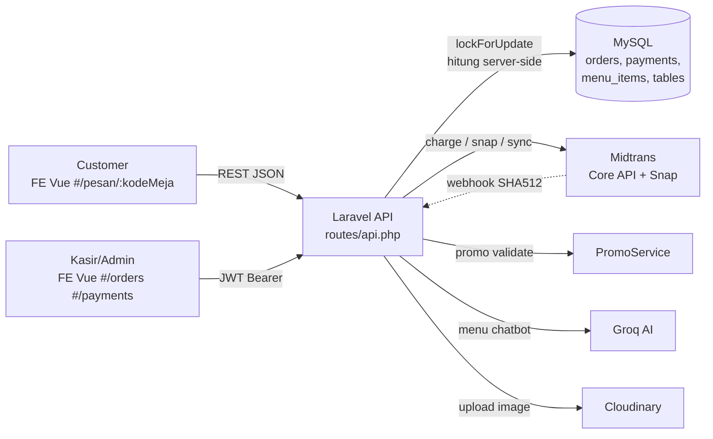
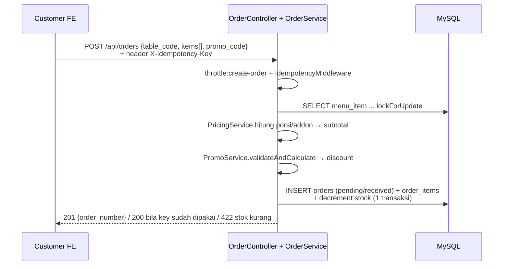
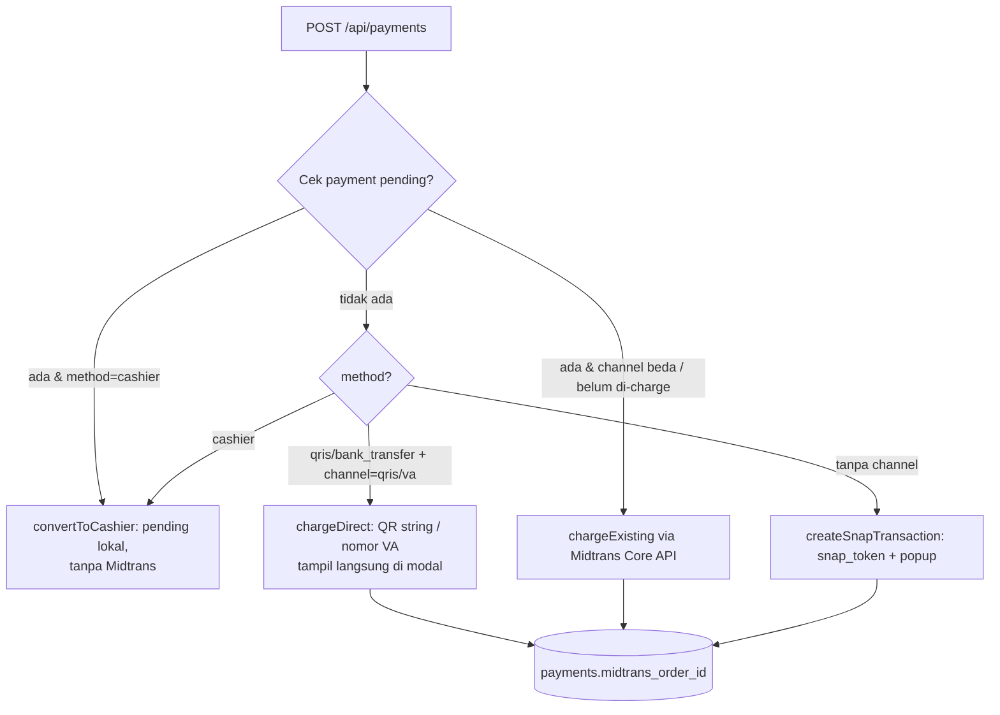
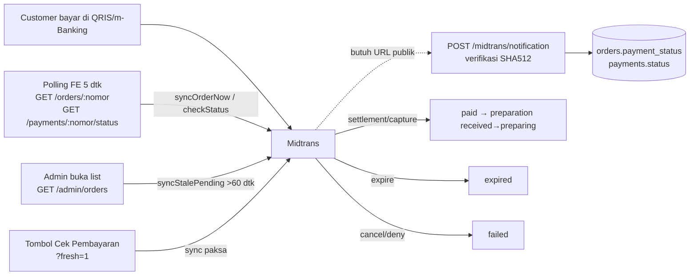

# Daftar Endpoint MejaKu (Laravel) + Alur

Sumber: `backend/swagger.yaml` (OpenAPI 3.0) — 43 path, 56 operasi. Base URL `http://localhost:8000`.
Auth admin: JWT Bearer (`POST /api/admin/auth/login` → pakai token di header `Authorization`).
- Docs interaktif: `GET /api/docs` (Swagger UI), `GET /api/docs.yaml`, `GET /api/docs.json`.

## 0. Alur Sistem

### 0.1 Arsitektur umum



Lokasi kode: `backend/routes/api.php`, `backend/app/Services/OrderService.php`,
`backend/app/Services/PaymentService.php`, `backend/app/Services/MidtransService.php`.

### 0.2 Order — buat pesanan (`POST /api/orders`)



Aturan: harga selalu dihitung ulang server-side, stok dicek + dipotong dalam
transaksi yang sama (`lockForUpdate`) agar anti-oversell. `order_number` format
`MJK-{total}-{2 huruf acak}`.

### 0.3 Pembayaran — tiga cabang (`POST /api/payments/{orderNumber}`)



- `channel: qris` → `payment_type=qris`, `qr_data` diisi `qr_string`.
- `channel: va` + `bank: bca/bri/bni/permata` → `va_number` + `va_bank`.
- Tanpa channel → Snap popup (semua metode).
- `cashier` → `payment_type=cashier`, `expires_at=null`, dilunasi manual admin.
- Payment ganda tidak dibuat: pending yang masih hidup dikembalikan (`is_existing: true`).

### 0.4 Sinkron status Midtrans — tanpa webhook pun lunas



Mapping: `capture+accept/settlement → paid`, `pending → pending`,
`expire → expired`, `cancel/deny/refund → failed`. Saat `paid`,
`preparation_status: received → preparing` otomatis.

### 0.5 Dapur & kasir — status ganda

```
payment_status:     pending → paid | expired | failed | cancelled
preparation_status: received → preparing → ready → completed
```

- Customer lunas → dapur otomatis `preparing`.
- Admin/kasir: `PATCH /admin/orders/{nomor}/preparation` (maju dapur),
  `PATCH .../payment` (tandai lunas tunai → buat record kasir bila belum ada),
  `POST .../cancel` (batal + `increment` stok kembali; 422 bila sudah `paid`).
- Throttle: `create-order` 5/mnt, `payment` 10/mnt, `chatbot` 10/mnt.

### 0.6 Admin & pendukung

- Auth: `POST /admin/auth/login` → JWT Bearer → `auth:api` untuk semua
  `/api/admin/*`. `logout` = blacklist token.
- Katalog: menu (porsi/addon = replace penuh, `image: null` hapus foto,
  `DELETE` soft / `?force=1` permanen), merchant single (tolak 409 bila sudah
  ada 1), meja (`code` uppercase, tolak 409 bila ada order aktif), promo
  (percentage 1–100, order simpan snapshot kode).
- Upload: `POST /admin/menu/upload-image` (multipart → Cloudinary → `{url, public_id}`).
- Chat: `POST /api/chat` + `/chat/stream` (SSE) via `ChatbotService` → Groq,
  503 bila key kosong.
- Rating: `POST /api/menu/{id}/rate` (+ `order_number` opsional; bila diisi
  order harus lunas & berisi menu itu, kalau tidak 422).

## 1. Publik — Menu & Merchant (7)

| Method & Path | Alur / Keterangan |
|---|---|
| `GET /api/menu` | Daftar menu `is_available` + merchant, rating, image |
| `GET /api/menu/{slug}` | Detail: porsi, addon, flag pedas, semua level pedas, 5 ulasan terbaru |
| `POST /api/menu/{id}/rate` | Nilai 1–5. Jika sertakan `order_number`, order harus lunas & berisi menu itu, kalau tidak → 422 |
| `GET /api/menu/{id}/reviews` | Ulasan + paginasi |
| `GET /api/merchants/{id}` | Info merchant + menu ringkas |
| `GET /api/spice-levels` | Daftar level pedas global |
| `GET /api/admin/menu/upload-image` | — (admin, lihat bagian 8) |

## 2. Meja (2)

| Method & Path | Alur / Keterangan |
|---|---|
| `GET /api/tables` | Meja aktif (untuk dropdown kasir) |
| `GET /api/tables/{code}` | Validasi QR → 200 valid / 404 kode salah atau nonaktif |

## 3. Order / Pesanan (3)

| Method & Path | Alur / Keterangan |
|---|---|
| `POST /api/orders` | Header opsional `X-Idempotency-Key`. Hitung harga server-side, tolak bila stok kurang/menu nonaktif, potong stok anti-oversell (`lockForUpdate`). 200 bila idempotency key sudah pernah dipakai |
| `GET /api/orders/{orderNumber}` | Detail + item + payment. Auto-sinkron Midtrans bila ada `midtrans_order_id`; `?fresh=1` memaksa sinkron (lewati throttle 30 dtk) |
| `PATCH /api/orders/{orderNumber}/status` 🔒 | Update status dapur (admin). `received→preparing→ready→completed` |

## 4. Pembayaran (5)

| Method & Path | Alur / Keterangan |
|---|---|
| `POST /api/payments/{orderNumber}` | Buat tagihan. `method`: `qris`/`bank_transfer`/`e_wallet`/`midtrans` (Snap) /`cashier`. `channel: qris/va` + `bank` untuk charge langsung (QR string / nomor VA tampil di modal). Tanpa channel → Snap popup |
| `GET /api/payments/{orderNumber}/status` | Cek status + sinkron Midtrans langsung (tanpa throttle). Dipakai tombol "Cek Pembayaran" |
| `POST /api/payments/{orderNumber}/simulate` | Simulasi `pay/fail/expire`. 403 bila bukan mode demo |
| `GET /api/payments/finish` | Landing pasca-Snap |
| `POST /api/midtrans/notification` | Webhook (verifikasi SHA512). Butuh URL publik — localhost tidak terjangkau Midtrans |

## 5. Promo & Chat (4)

| Method & Path | Alur / Keterangan |
|---|---|
| `GET /api/promos` | Promo aktif |
| `POST /api/promo/validate` | `{code, subtotal}` → `{valid, discount}` |
| `POST /api/chat` | Chatbot Groq (10/mnt). 503 bila key kosong |
| `POST /api/chat/stream` | SSE streaming |

## 6. Admin Auth (3) 🔒 = JWT

| Method & Path | Alur / Keterangan |
|---|---|
| `POST /api/admin/auth/login` | Email+password → `{user, token, token_type: Bearer, expires_in}`. Token lama Sanctum tidak berlaku |
| `POST /api/admin/auth/logout` | Blacklist JWT aktif (token langsung mati) |
| `GET /api/admin/auth/me` | Profil admin |

## 7. Admin Order (5) 🔒

| Method & Path | Alur / Keterangan |
|---|---|
| `GET /api/admin/orders` | Filter `payment_status/preparation_status/search/table_code/sort`. Sinkronkan pending basi (>60 dtk) dulu |
| `GET /api/admin/orders/{orderNumber}` | Detail + `?fresh=1` paksa sinkron |
| `PATCH .../preparation` | Status dapur |
| `PATCH .../payment` | Tandai lunas manual (buat record kasir bila belum ada; `received`→`preparing` otomatis) |
| `POST .../cancel` | Batal + kembalikan stok. 422 bila sudah lunas |

## 8. Admin Katalog (25) 🔒

**Meja (6):** `GET+POST /admin/tables`, `GET+PUT+DELETE /admin/tables/{id}` (tolak 409 bila ada order aktif), `PATCH /admin/tables/{id}/toggle`. Kode selalu uppercase.

**Promo (5):** `GET+POST /admin/promos` (percentage 1–100), `GET+PUT+DELETE /admin/promos/{id}` (hard delete; order menyimpan snapshot kode).

**Menu (7):** `GET+POST /admin/menu` (merchant otomatis = satu-satunya; `merchant_id` dikirim pun diabaikan), `POST /admin/menu/upload-image` (multipart → Cloudinary, balas `{url, public_id}`), `GET+PUT+DELETE /admin/menu/{id}` (kirim portions/addons = replace penuh; hapus foto = kirim `image: null`; DELETE = soft, `?force=1` permanen), `PATCH /admin/menu/{id}/toggle`.

**Merchant (5):** `GET+POST /admin/merchants` (tolak 409 bila sudah ada 1 — konsep single merchant), `GET+PUT+DELETE /admin/merchants/{id}` (tolak hapus merchant terakhir / yang masih punya menu tanpa `?force=1`).

**Lainnya (4):** `GET /admin/stats` (`?date=` untuk grafik), `GET+PUT /admin/store/status` (buka/tutup toko), `GET /api/admin/payments` (rekap + ringkasan lunas).

## Alur ujung-ke-ujung (customer)
1. Scan QR → `GET /api/tables/{code}` → 2. `GET /api/menu` → pilih porsi/addon → 3. `POST /api/orders` (201 + `order_number`) → 4. `POST /api/payments/{nomor}` (`channel: qris/va` atau Snap) → 5. Bayar → 6. `GET /api/payments/{nomor}/status` sampai `paid` → 7. Dapur: `PATCH .../preparation` → `ready` → `completed`. Nilai: `POST /api/menu/{id}/rate` (+ `order_number` lunas).

## Alur kasir (admin)
Login → `GET /admin/orders` (tab Menunggu) → Bayar (QRIS/VA/Snap) atau Tandai Lunas → Mulai Siapkan → Siap → Selesai. Batal via `POST .../cancel` (stok kembali).
